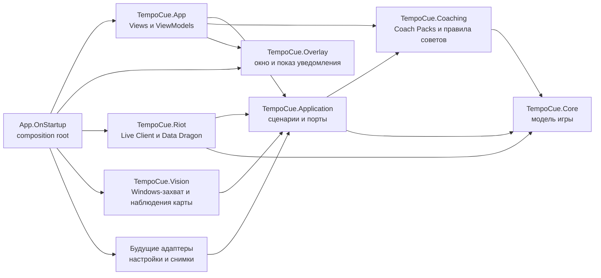

# Архитектура TempoCue

Статус: обязательная архитектурная база проекта. Документ описывает целевое направление и правила для нового кода. Текущий код приводится к нему постепенно, когда затрагивается соответствующая функция; отдельное «переписывание всего приложения» не требуется.

## Зачем нужны эти правила

Архитектура должна удерживать стоимость изменений, а не демонстрировать количество паттернов. Хороший результат выглядит так:

- новое правило матча не требует менять WPF и Riot-клиент;
- изменение Riot JSON не затрагивает движок советов;
- новый экран не увеличивает ответственность `MainWindow`;
- сценарий можно проверить без окна, сети и запущенной League of Legends;
- у изменяемого состояния есть один владелец;
- удаление или замена внешней технологии не переписывает предметную логику.

Если обычная функция требует правок во многих несвязанных местах, дублирования условий или знания деталей соседнего слоя, это архитектурный сигнал. Нужно сначала найти отсутствующую границу или неправильного владельца поведения, а не добавлять ещё один обходной путь.

## Текущее состояние

### Что уже сделано правильно

- `TempoCue.Core` отделяет модель матча и нормализованные игровые факты от WPF.
- `TempoCue.Coaching` отделяет переносимые Coach Packs, их проверку и
  детерминированные правила советов от модели получения данных и интерфейса.
- `TempoCue.Application` владеет сценарием активной сессии и портом источника снимков. `ActiveMatchMonitor` запускает единственный цикл polling, хранит последнее типизированное обновление и публикует его нескольким независимым потребителям; экран текущего матча больше не владеет жизненным циклом опроса.
- `TempoCue.Riot` изолирует DTO внешних Riot API и преобразует их в модели Core. Отдельный
  адаптер Champion Select использует локальный League Client API и применяет границу
  приватности до создания доменной модели: профиль запрашивается только при явном
  `nameVisibilityType = VISIBLE`.
- `TempoCue.Overlay` изолирует отдельное всегда-поверх-окон WPF-окно. Оно принимает готовый `OverlayNotification`, не знает Riot DTO, Core-модели, Coach Pack и локализацию приложения; детерминированный `OverlayNotificationScheduler` отвечает за два слота, приоритеты и время жизни, а жизненным циклом единственного окна владеет `OverlayHost`, созданный в composition root. `ActiveMatchOverlayCoordinator` в App подписывается на общий поток матча, преобразует уже выбранные матчапные и картографические советы в нейтральные уведомления, не допускает их повторной подачи при каждом polling и управляет общей ротацией применимых постоянных подсказок матчапа и контроля карты при повышении уровня.
- `TempoCue.Vision` изолирует Windows Graphics Capture и Direct3D-ресурсы. Адаптер владеет
  диагностической сессией, ограничивает будущий анализ до 30 FPS и публикует метрики захвата.
  Для проверки геометрии Direct3D до 4 раз в секунду копирует в CPU ограниченные поисковые зоны
  нижних углов. `MinimapRegionDetector` оценивает согласованность верхней и боковой границ
  квадрата, после чего последующие копирования используют только найденную миникарту. WPF получает
  неизменяемый BGRA-снимок, координаты, сторону и уверенность. `MinimapFrameNormalizer`
  билинейно приводит найденную область любого масштаба к каноническим `320 × 320` пикселям;
  алгоритм умеет писать в переданный буфер, чтобы будущий цикл распознавания не создавал большой
  массив на каждом кадре. Direct3D-ридер также переиспользует три временных BGRA-буфера для
  левой поисковой области, правой поисковой области и найденной миникарты; при завершении сессии
  они очищаются. Новый массив создаётся только для публикуемого неизменяемого диагностического
  снимка с ограничением 4 FPS. Полные сырые кадры, поверхности
  Direct3D и Windows-типы не попадают в App, Core, Coaching и Riot.
  `MinimapMarkerCandidateDetector` на каноническом кадре выделяет компактные цветные контуры
  команд, а `MinimapChampionProposalGenerator` центрирует на них области ожидаемого размера
  портрета и объединяет близкие находки. Цвет остаётся только генератором предложений: башни и
  миньоны на реальном кадре могут выглядеть сходно, а жёсткие пороги формы способны отбрасывать
  настоящие портреты. Внутренний `IMinimapChampionRecognizer` отделяет этот шаг от захвата:
  основная реализация на OpenCV подтверждает предложение цветовым сравнением с нейтральными
  BGRA-эталонами и отклоняет области, похожие на встроенные эталоны статичных объектов
  интерфейса — башни, строения базы, метки и миньонов — не слабее, чем на любой портрет;
  управляемая реализация сохраняется как базовая линия. Назначения выбираются
  с учётом всего состава: сначала закрепляются однозначные сильные совпадения,
  затем близкая по баллу альтернатива может занять уже свободного участника той же
  стороны контура. Один эталон участника назначается не более чем одной области,
  а неоднозначность не распределяет по оставшимся участникам далёкие совпадения.
  `ActiveMatchVisionCoordinator` в App
  сопоставляет Core-модель участников с каталогом чемпионов и передаёт Vision только десять
  нормализованных портретов. Этот же координатор публикует только для диагностического UI
  неизменяемую проекцию абсолютной команды Riot и стороны относительно активного игрока;
  относительная сторона подтверждённого портрета берётся из нейтрального эталона участника,
  подготовленного по Core-модели матча, а не из шумного цвета контура. Исходная сторона контура
  сохраняется только для диагностики. Vision не знает Riot DTO, HTTP и
  Data Dragon. Подтверждённый портрет публикуется как наблюдение одного кадра через нейтральный
  порт. `ParticipantVisibilityTracker` в Application требует двух наблюдений с интервалом не
  более 600 миллисекунд, удерживает короткий период исчезновения и хранит последние
  нормализованные координаты; пропуск отдельного кадра между наблюдениями подтверждение не
  сбрасывает. App сопоставляет наблюдения с конкретными участниками и исключает мёртвых по
  Core-модели матча. Неудачное чтение миникарты публикуется как кадр без кандидатов с явным
  признаком неуспеха: удержание видимости истекает и без успешных кадров, но такой кадр не
  подтверждает работоспособность потока — продолжительные ошибки чтения, как и полное
  отсутствие кадров, переводят статусы в явное «нет данных» вместо догадки «не виден».
  Временный сбой подготовки портретов повторяется с ограниченной частотой. Только этот устойчивый
  снимок может стать входом будущего сценария контроля карты; WPF отображает его, но не
  принимает решение о видимости.
- Riot-клиент допускает подстановку `HttpClient`, поэтому проверяется без реальной сети.
- Каталоги патчей, чемпионов и предметов объявлены портами Application. Общий `DataDragonClient` в адаптере Riot владеет HTTP-доступом, списком версий и адресами ресурсов; специализированные каталоги владеют преобразованием и собственным локальным кешем. Каталог предметов загружает данные для выбранного игрового патча и языка и на границе Riot нормализует цену, известные характеристики и категорию из внешних `tags`, `depth` и компонентов сборки. UI получает готовую внутреннюю модель и не интерпретирует поля Data Dragon. Будущие каталоги других статических данных используют тот же клиент, но имеют отдельные внутренние модели и правила кеширования.
- Экран текущего матча выделен в отдельные View/ViewModel и получает готовое состояние через binding.
- Главная страница и настройки выделены в отдельные View/ViewModel; `MainWindow` размещает готовые экраны и не содержит их разметку.
- Библиотека коучинга реализована самостоятельными `CoachingLibraryView`/`CoachingLibraryViewModel`: список встроенных наборов загружается composition root из `Assets/CoachPacks`, а пользовательские наборы — через `LoadCoachPackLibraryUseCase`. Каталог встроенных наборов может быть пустым; текущая сборка не поставляет готовый Coach Pack. Родительский `CoachingViewModel` только координирует переходы между библиотекой, выбором типа и редактором. Пошаговый редактор хранит общее состояние навигации в `MatchupEditorViewModel`, а данные и представление каждого реализованного шага выделяются в собственные View/ViewModel. Крупный шаг может компоновать более узкие представления без создания дополнительных ViewModel: содержание матчапа отдельно размещает форму фазы, рекомендации предметов и список сохранённых фаз, которые используют один `MatchupContentViewModel`.
- Просмотр сохранённого набора выделен в `CoachingPackDetailsView`/`CoachingPackDetailsViewModel` и получает итоговую модель `CoachPack` из карточки библиотеки. Вкладки просмотра не используют рабочее состояние редактора. Собственный набор загружается в редактор как рабочая копия с сохранением идентификатора, а для встроенного или импортированного набора редактор создаёт независимую копию с новым идентификатором и метаданными происхождения. Сборка League item set JSON принадлежит `BuildLeagueItemSetExportUseCase` в Application: сценарий проверяет числовой ID чемпиона и предметы через каталоги, а WPF только координирует буфер обмена и выбранный пользователем файл. Полный переносимый Coach Pack записывает `ExportCoachPackUseCase`: Application повторно проверяет доменную модель и пишет её в переданный поток, а WPF отвечает только за диалог выбора файла. Локальное состояние библиотеки в экспорт не входит.
- Финальное сохранение редактора проходит через `SaveCoachPackUseCase`; преобразование состояния редактора в переносимую модель Coaching изолировано в `MatchupCoachPackFactory`. Чтение библиотеки выполняет `LoadCoachPackLibraryUseCase`, импорт переносимого файла — `ImportCoachPackUseCase`, переключение готового набора — `SetCoachPackStateUseCase`, а удаление локального экземпляра — `DeleteCoachPackUseCase`; все сценарии используют порт `ICoachPackStore` в Application. Импорт повторно проверяет схему через Coaching, защищает идентификаторы собственных и встроенных наборов и разрешает замену только существующей импортированной установки. Реализация `LocalCoachPackStore` находится во внешнем WPF-проекте и единственная знает путь `%LocalAppData%/TempoCue/CoachPacks`; переносимый Coach Pack и локальное состояние «черновик/включён/выключен» записываются, читаются и удаляются раздельно. Перед удалением хранилище повторно читает файл и сверяет его доменный ID; отсутствие локального файла защищает встроенные наборы от удаления. `LocalCoachingPackStateSerializer` владеет версией и JSON-схемой служебного файла состояния, включая локальное происхождение `CreatedByUser`/`Imported`. Оно определяет право редактирования в этом экземпляре приложения и не подменяет будущую серверную проверку авторства.
- Наборы контроля карты используют параллельные сценарии `SaveMapControlPackUseCase`, `LoadMapControlPackLibraryUseCase`, `ImportMapControlPackUseCase`, `SetMapControlPackStateUseCase`, `DeleteMapControlPackUseCase` и `ExportMapControlPackUseCase` через отдельный порт `IMapControlPackStore`. Адаптер `LocalMapControlPackStore` хранит их в `%LocalAppData%/TempoCue/MapControlPacks`, поэтому матчапный и картографический JSON не интерпретируются одной библиотекой. Оба адаптера переиспользуют внутренний `LocalCoachingPackFileStore<TPack>` для атомарной записи, защиты безопасного имени файла, сериализации локального состояния и согласования конкурентных операций, но сохраняют типизированные контракты Application.
- `MapControlPackPlanner` в Coaching строит детерминированный хронологический план правил объектов и напоминаний по времени. `SelectActiveMapControlPacksUseCase` в Application загружает и кеширует включённые наборы, отбирает их по роли и стороне активного игрока, передаёт план через `ActiveMatchUpdate` и не знает о WPF либо устройстве оверлея. Подтверждённые события дракона, Герольда и Барона нормализуются в Core, а отсутствие надёжного события объекта не заменяется догадкой.
- Выбор набора для активного снимка выполняет `SelectActiveCoachPackUseCase` в Application. Он получает проверенные данные через `LoadCoachPackLibraryUseCase`, кеширует снимок библиотеки и инвалидируется после сохранения либо изменения локального состояния. `ActiveMatchSession` зависит от порта `IMatchAdviceSelector`, поэтому не знает ни файловых путей, ни WPF, ни происхождения Coach Pack. `ActiveMatchMonitor` является единственным владельцем вызова `WatchAsync`: он публикует один и тот же `ActiveMatchUpdate` экрану матча и будущему оверлею, а новый подписчик может сразу прочитать `CurrentUpdate`. Пользовательский набор имеет приоритет над встроенным только при единственном совпадении; несколько пользовательских совпадений представлены явным конфликтом.
- Экземпляр `AppSettingsService` создаётся в composition root и явно передаётся странице настроек.
- Core, Application и Riot имеют быстрые тесты; WPF-локализация и навигация проверяются отдельно.

### Следующая граница роста

`MainWindow` теперь является оконной оболочкой: системные кнопки, боковая навигация, общие индикаторы матча и размещение самостоятельных View. Переключение экранов пока остаётся небольшим явным `AppPage`/`NavigateTo`, потому что для текущего количества страниц отдельный навигационный фреймворк не даёт проверяемой пользы.

Новые экраны добавляются отдельными View/ViewModel. Если ручное переключение начнёт дублировать состояние, заголовки и правила доступности, навигацию следует выделить в собственную ViewModel небольшим отдельным изменением, а не заранее строить универсальный маршрутизатор.

`LocalizationService.Instance` появился как простая граница прототипа и не считается образцом для новых глобальных сервисов. Локализация уже передаётся ViewModel явно, хотя XAML-расширение пока использует общий экземпляр. `CoachPackLoader` принимает только поток и выполняет доменную проверку содержимого; выбор пути и открытие файла остаются во внешнем App-слое.

## Основные принципы

### 1. Зависимости направлены к правилам продукта

Предметная логика не знает о WPF, HTTP, JSON Riot, файловых путях и способе хранения настроек. Внешние механизмы зависят от стабильных внутренних контрактов.

### 2. Одна причина изменения — один владелец

- изменения правил League of Legends принадлежат домену и Coach Packs;
- порядок выполнения пользовательского сценария принадлежит слою Application;
- формат Riot API принадлежит адаптеру Riot;
- состояние конкретного экрана и его команды принадлежат ViewModel;
- внешний вид и механика WPF принадлежат View.

Нельзя размещать одну и ту же бизнес-проверку в окне, адаптере и Core. У правила должен быть единственный канонический владелец.

### 3. Явные зависимости вместо скрытого глобального состояния

Зависимости передаются через конструкторы. Статические классы допустимы для чистых функций и неизменяемых констант, но не как хранилище изменяемого состояния или скрытый доступ к сети, диску и настройкам.

Интерфейс вводится на значимой границе: сеть, файловая система, часы, настройки, запись снимков либо несколько реальных реализаций. Интерфейс «для каждого класса» не требуется.

### 4. Состояние имеет одного владельца

Для каждого изменяемого значения можно ответить:

- кто его создаёт;
- кто имеет право менять;
- сколько оно живёт;
- как наблюдатели узнают об изменении;
- кто отменяет работу и освобождает ресурсы.

Копии одного состояния в нескольких полях допустимы только как явно производные представления. Они не должны обновляться независимыми цепочками событий.

### 5. Архитектура растёт по фактической сложности

Не создавай абстракцию для гипотетического будущего, универсальный `Manager`, `Helper`, `BaseService` или generic repository без конкретной необходимости. Сначала выделяется предметное имя и ответственность, затем минимальный контракт.

Дублирование одинакового синтаксиса не всегда проблема. Дублирование одного бизнес-правила в двух местах — проблема всегда.

## Целевая модель модулей



`TempoCue.Application` создан вместе с первым реальным сценарием — управлением активной сессией матча. Новые сценарии добавляются в него только при наличии фактической координации Core и внешнего эффекта; пустые классы-переадресаторы заранее не создаются.

`TempoCue.Overlay` является внешним WPF-механизмом, а не новым слоем предметной логики. В текущей итерации он работает в процессе `TempoCue.App`: приложение локализует системные подписи и вызывает порт показа. Общая механика частоты, вытеснения и скрытия нейтральных уведомлений находится в планировщике Overlay. `ActiveMatchOverlayCoordinator` владеет первой подачей совета при смене активной фазы и детерминированной ротацией постоянных подсказок при повышении уровня, но не выбирает фазовое правило повторно; само окно не подписывается на `ActiveMatchMonitor`. Политика постоянных подсказок остаётся в координаторе и не смешивается ни с планировщиком окна, ни с детерминированным выбором фаз в Coaching.

### TempoCue.Core

Содержит:

- модели и инварианты матча;
- определение матчапа;
- нормализованные игровые события;
- чистые преобразования игровых фактов, основанные только на входных значениях.

Не содержит:

- типов `System.Windows`;
- циклов опроса, таймеров и UI-состояния;
- Riot DTO и HTTP;
- пользовательских настроек и платформенных путей;
- логирования и обработки ошибок, зависящих от конкретного интерфейса.

Core по возможности детерминирован: время и случайность не читаются напрямую из глобальных источников, если они влияют на решение.

### TempoCue.Coaching

Содержит:

- переносимые модели Coach Pack и их независимые версии схем;
- проверку и потоковую сериализацию авторского содержимого;
- детерминированный выбор матчап-совета;
- фазовые правила и оценку силы в матчапе;
- патч-зависимые знания о таймингах объектов;
- планирование напоминаний контроля карты из нормализованных игровых событий.

Coaching зависит только от Core. Он не читает Riot DTO, файлы или настройки, не знает
о WPF и не показывает оверлей. Матчапный Coach Pack и будущий Map Control Pack остаются
разными корневыми моделями: общий модуль не превращает их в один JSON с необязательными
полями.

### TempoCue.Application

Содержит сценарии приложения, например:

- начать и завершить наблюдение за матчем;
- получить очередной снимок и вычислить изменение совета;
- записать или воспроизвести последовательность снимков;
- загрузить доступные Coach Packs;
- сохранить пользовательский выбор.

Application координирует Core и порты внешнего мира, но не знает о WPF-контролах, `Dispatcher`, Riot DTO, конкретном JSON-сериализаторе и файловых путях.

Один публичный сценарий должен иметь явный вход и явный результат. Ожидаемые состояния вроде «игра не запущена» выражаются типизированным результатом, а не используются как исключения общего назначения.

Порты объявляются со стороны потребителя и имеют предметные имена, например `IMatchSnapshotSource` или `IMatchRecordingStore`, а не технические `IDataService`/`IRepository<T>`.

### TempoCue.Riot, TempoCue.Vision и будущие адаптеры

Адаптер:

- знает протокол, endpoint, сертификат, DTO и особенности внешнего формата;
- проверяет структурную корректность ответа;
- нормализует локализованные и нестабильные внешние значения;
- реализует порт Application;
- возвращает внутренний тип результата, не раскрывая Riot DTO наружу.

Изменение внешнего формата должно локализоваться в DTO, mapper и тестовых fixtures адаптера.

Настройки, запись файлов, база данных, звук и компьютерное зрение также считаются внешними адаптерами. Их нельзя подключать напрямую из ViewModel или Core.

`TempoCue.Vision` владеет только платформенной механикой захвата, памятью кадров, выделением
области интереса и будущим преобразованием изображения в нормализованные наблюдения.
Диагностический предпросмотр является ограниченным снимком области интереса, а не игровым
фактом. Решение о том, достаточно ли наблюдение надёжно для игрового факта, задаётся проверяемым
сценарием через порт Application, а не WPF-обработчиком и не окном оверлея.
Портреты участников передаются в Vision через узкий входной порт в виде фиксированных BGRA-эталонов;
загрузка каталога и изображений остаётся во внешней координации App и не меняет направление
зависимостей Vision. OpenCV остаётся внутренней деталью адаптера за
`IMinimapChampionRecognizer`; его типы не передаются в Application, Core или WPF.

### TempoCue.App

`App.OnStartup` является composition root: здесь создаётся граф объектов, выбираются реализации портов и задаётся их жизненный цикл. Остальной UI получает готовые зависимости и не использует service locator.

Для нового UI применяется следующая структура:

- View (`Window`, `UserControl`, XAML) — разметка, ресурсы, визуальные состояния и чисто оконная механика;
- ViewModel — состояние представления, команды и вызов сценариев Application;
- Application — последовательность действий и решения, не зависящие от WPF;
- Core — предметные правила.

Code-behind допустим для `DragMove`, focus, анимации, системных кнопок, преобразования специфичных `EventArgs` и другой механики View. Он не должен выполнять HTTP, читать файлы, строить доменные модели или принимать бизнес-решения.

Новый самостоятельный экран создаётся отдельным `UserControl`/View и ViewModel. Не добавляй очередную страницу непосредственно в `MainWindow.xaml`; `MainWindow` постепенно становится оболочкой с навигацией и размещением текущего View.

Используй WPF binding и команды для синхронизации состояния. ViewModel не должен хранить ссылки на `TextBox`, `ComboBox`, `Window`, `Brush` или другие визуальные элементы. Цвета, шаблоны и конвертеры остаются во View.

MVVM-фреймворк не является обязательным. Сначала достаточно небольших собственных базовых механизмов; внешняя библиотека добавляется только после согласования и при измеримой выгоде.

## Поток данных активного матча

Канонический поток однонаправленный:

```text
Riot JSON
  -> Riot DTO
  -> нормализованный MatchSnapshot / MatchState
  -> сценарий активной сессии
  -> MatchupCoach
  -> состояние ViewModel
  -> WPF binding
```

Публичный Riot ID участника является отдельным значением Core и не выводится из
технического `ParticipantId`. Регион для внешней ссылки на профиль приходит через порт
Application из локального адаптера Riot; при отсутствии региона UI показывает имя без
ссылки. View не читает конфигурацию League и не получает Riot DTO.

До появления Live Client Data тот же сценарий сессии может опубликовать состояние Champion
Select через отдельный порт `IChampionSelectSource`:

```text
League Client HTTPS API на loopback
  -> изолированные Champion Select DTO
  -> проверка nameVisibilityType и нормализованный ChampionSelectState
  -> ActiveMatchSession
  -> CurrentMatchViewModel
  -> WPF binding
```

Активный матч всегда имеет приоритет: при успешном снимке Live Client Data источник
Champion Select не опрашивается. Значение личности попадает в Core только при явном
`VISIBLE`; `HIDDEN`, отсутствующее и неизвестное значения не запускают получение профиля.
Пароль локального League Client используется только внутри адаптера Riot и не сохраняется.

Пользовательское действие идёт в обратном направлении как команда, а не как произвольное изменение нескольких контролов:

```text
View -> Command -> Application use case -> новый результат -> ViewModel -> View
```

Ни View, ни ViewModel не должны принимать решения по значениям локализованных строк. Ветвление выполняется по enum, ID или типизированному состоянию, а перевод применяется в самом внешнем слое.

## Асинхронность и жизненный цикл

- Асинхронность проходит до вызывающего слоя; `.Wait()`, `.Result` и блокирующие ожидания в UI запрещены.
- `async void` допустим только для WPF event handlers. Остальные асинхронные методы возвращают `Task`/`Task<T>`.
- Долгоживущий процесс имеет владельца, `CancellationToken` и явное завершение.
- В один момент работает не более одного цикла опроса одной сессии. Повторное нажатие не должно незаметно запускать конкурирующий цикл.
- Внешний адаптер не обновляет UI. Результат передаётся наверх; переход на UI-поток выполняется в App.
- Владелец созданного `IDisposable`/`IAsyncDisposable` отвечает за освобождение. Если объект создаёт DI-контейнер, его жизненным циклом управляет контейнер.

## Ошибки и наблюдаемость

Разделяй три вида исходов:

1. Ожидаемое состояние: игра не запущена, матч закончился, правило отсутствует.
2. Некорректные внешние данные: неизвестная схема, обязательное поле отсутствует, противоречивый Coach Pack.
3. Сбой: timeout, недоступный файл, непредвиденная ошибка приложения.

Application преобразует технические ошибки адаптера в небольшой набор осмысленных исходов. UI выбирает локализованное представление и не анализирует текст `Exception.Message`.

Логи и диагностические снимки должны помогать восстановить цепочку событий, но не содержать секреты и реальные Riot ID. Исключение нельзя игнорировать без комментария, объясняющего, почему исход ожидаем и как система продолжает работу.

## Правила моделей и контрактов

- Доменные типы представляют смысл, а не форму экрана или JSON.
- Невозможное состояние лучше исключить конструктором/фабрикой и проверкой границы, чем многократно проверять внутри алгоритма.
- Коллекции, передаваемые как снимок состояния, не должны меняться из-под потребителя.
- Публичный контракт меняется осознанно: обновляются потребители, тесты и документация.
- Не используй `Dictionary<string, object>`, строки-флаги и `bool` с неясным смыслом там, где подходит отдельный тип или enum.
- Не передавай сырой `IServiceProvider` за пределы composition root.

## Стратегия тестирования

```text
много быстрых тестов Core и Coaching
        + тесты сценариев Application с подставными портами
        + контрактные тесты адаптеров на обезличенных данных
        + немного WPF-тестов binding/навигации
        + ручная проверка реального матча
```

- Игровые инварианты Core и доменное поведение Coaching тестируются без файлов, сети,
  часов и WPF. Контракт загрузчика Coach Pack отдельно проверяется через поток в памяти
  и может проверяться интеграционным тестом настоящего обезличенного asset-файла.
- Application тестируется без WPF и реальных адаптеров.
- Riot mapper и client тестируются на зафиксированных обезличенных ответах.
- WPF-тест проверяет только то, что действительно относится к WPF; бизнес-ветвление не доказывается через поиск контролов.
- Каждый дефект на границе получает regression test на самом низком слое, который способен его воспроизвести.

## Как добавлять функцию

Перед реализацией ответь на вопросы:

1. Какое наблюдаемое поведение получает пользователь?
2. Какой слой владеет новым решением?
3. Какие вход и результат у сценария?
4. Есть ли внешний эффект и какой порт его изолирует?
5. Кто владеет новым состоянием и его жизненным циклом?
6. Как проверить поведение без UI и реальной сети?
7. Какие существующие модули действительно должны измениться?

Обычный путь реализации:

1. Добавить или уточнить доменное правило и его тесты, если меняется предметное решение.
2. Добавить сценарий Application и порт внешнего эффекта.
3. Реализовать/изменить адаптер с контрактными тестами.
4. Представить результат во ViewModel.
5. Связать View через binding и команды.
6. Выполнить полную проверку и обновить документацию.

Если функция вынуждает View знать Riot DTO, Riot-клиент знать WPF, а Core читать файлы интерфейса, реализацию нужно остановить и пересмотреть границы.

## Ограничители сложности

- Циклические project references запрещены.
- Новый проект создаётся только для отдельной политики зависимостей или заменяемого внешнего механизма, а не ради папки.
- Новый сервис не называется `Manager`, `Helper` или `Common`, пока не сформулирована одна предметная ответственность.
- Булевы параметры, меняющие режим метода, обычно разделяются на именованные операции или типизированные options.
- Публичный метод не должен требовать от вызывающего правильного скрытого порядка нескольких вызовов; жизненный цикл выражается отдельным объектом или явным состоянием.
- Если одно изменение регулярно требует синхронно редактировать три и более представления одного правила, должен появиться единый источник истины.
- Если тестирование класса требует поднимать окно, сеть и файловую систему одновременно, класс смешивает ответственности.
- Производительность оптимизируется после измерения, кроме очевидного запрета блокировать UI и выполнять тяжёлую работу на каждом тике без необходимости.

## План постепенного перехода

Выполнено:

1. Сценарий активной сессии и порт источника снимков выделены в `TempoCue.Application`.
2. Riot client реализует этот порт; отсутствие матча и ошибки чтения представлены типизированными исходами.
3. Экран текущего матча выделен в собственные View и ViewModel.
4. Библиотека коучинга и редактор матчапа выделены в самостоятельные View/ViewModel; `CoachingViewModel` оставлен навигационным контейнером раздела.
5. Включённые пользовательские матчапы подключены к активной сессии через кешируемый сценарий выбора в Application.
6. Безопасный импорт Coach Pack выделен в Application, а локальный адаптер отдельно фиксирует происхождение `Imported`.

Следующие шаги:

1. Выделять общую навигационную ViewModel приложения только после появления реального дублирования между разделами.
2. При добавлении записи снимков создать порт хранения и отдельный адаптер; Core и View не должны знать формат файла или БД.

Каждый шаг должен оставлять приложение запускаемым. Временная совместимость допустима, если она явно локализована и не становится новым способом добавления функций.

## Архитектурные решения

Изменение направления зависимостей, новый внешний адаптер, новый формат хранения, новый UI-паттерн или production-зависимость фиксируются коротким ADR в `docs/adr/`. ADR объясняет контекст, принятое решение, альтернативы и последствия. Мелкие локальные рефакторинги ADR не требуют.

Шаблон и правила нумерации находятся в `docs/adr/README.md`.

## Основания

- [Microsoft: Common web application architectures](https://learn.microsoft.com/en-us/dotnet/architecture/modern-web-apps-azure/common-web-application-architectures) — направление зависимостей к Application Core, разделение UI и инфраструктуры, composition root.
- [Microsoft: WPF data binding overview](https://learn.microsoft.com/en-us/dotnet/desktop/wpf/data/) — binding как граница между представлением и данными, уведомления и коллекции.
- [Microsoft: Dependency injection guidelines](https://learn.microsoft.com/en-us/dotnet/core/extensions/dependency-injection/guidelines) — явные зависимости, жизненные циклы, освобождение ресурсов и ограничения singleton.
- [Microsoft: Unit testing best practices](https://learn.microsoft.com/en-us/dotnet/core/testing/unit-testing-best-practices) — быстрые, изолированные и повторяемые тесты без инфраструктуры.

Это источники принципов, а не требование копировать архитектуру веб-приложения. Правила выше адаптированы к локальному WPF-приложению TempoCue и его текущему масштабу.
