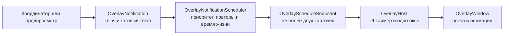

# Игровой оверлей TempoCue

## Текущее состояние

`TempoCue.Overlay` содержит нейтральный контракт уведомления, детерминированный планировщик и отдельное WPF-окно. Модуль не знает Riot DTO, `MatchState`, Coach Pack и язык интерфейса: приложение передаёт ему уже готовый текст и стабильный ключ события.

Текущая итерация реализует:

- два видимых слота без неограниченной очереди;
- обновление одного события на месте по стабильному ключу;
- порядок `Danger → Caution → Information → Coach → NoData`;
- отдельное постоянное состояние `Paused`;
- подавление завершившегося повтора на 20 секунд;
- ограниченную двумя элементами очередь ожидания, из которой устаревшие сообщения удаляются через 20 секунд;
- автоматическое исчезновение и WPF-анимации;
- игровой режим с пропусканием мыши и режим настройки с перетаскиванием и закрытием;
- локализованный пошаговый предпросмотр заполнения двух слотов и приоритетного вытеснения без League и Riot API.

Подключение реального `ActiveMatchUpdate` остаётся следующим шагом. Пока тестовое уведомление не читает Coach Pack и не является игровым советом.

## Поток данных

`OverlayNotificationScheduler` не использует WPF и системные таймеры. Текущее время передаётся каждым вызовом, поэтому одинаковая последовательность уведомлений и моментов времени всегда даёт одинаковый результат.

## Контракт уведомления

Уведомление содержит:

- `Key` — стабильный идентификатор события для обновления на месте и подавления повторов;
- `Status` — короткое название состояния;
- `Context` — необязательный тайминг, уровень или давность наблюдения;
- `Phrase` — одна основная фраза;
- `Source` — источник, причина или степень достоверности;
- `Badge` — необязательная системная метка;
- `Tone` — одно из шести визуальных состояний;
- `DismissLabel` — доступная подпись закрытия в режиме настройки.

В контракте нет WPF-цветов и игровых моделей. Матчапы и будущий контроль карты могут использовать один механизм, не расширяя окно знаниями о типах игровых событий.

## Приоритеты и вытеснение

1. `Danger` показывается немедленно, очищает менее важные карточки и занимает верхний слот.
2. `Caution` вытесняет активные `Coach` и `NoData`, но может находиться рядом с информационным событием.
3. `Information` предназначен для нейтральных фактов и таймеров.
4. `Coach` ожидает, пока нет активного `Danger` или `Caution`.
5. `NoData` имеет минимальный приоритет.
6. `Paused` очищает остальные карточки, не исчезает автоматически и блокирует новые уведомления до явного скрытия.

При одинаковом приоритете новое событие заменяет старое в том же уровне. Низкоприоритетные карточки показываются не чаще одной в восемь секунд; предупреждения обходят это ограничение. В очереди остаются только два наиболее важных и свежих события.

## Время жизни и анимации

| Состояние | Время жизни |
|---|---:|
| `Danger` | 8 секунд |
| `Caution` | 6 секунд |
| `Information` | 5 секунд |
| `Coach` | 7 секунд |
| `NoData` | 5 секунд |
| `Paused` | до явного скрытия |

- обычное появление: 180 мс, прозрачность `0 → 1` и сдвиг на 8 px;
- появление `Danger`: 120 мс без задержки;
- исчезновение: 150 мс, только затухание;
- обновление того же `Key`: без повторной анимации появления;
- при отключённых системных анимациях сдвиг не используется.

Фон карточки имеет непрозрачность 80%, а текст, цветовая полоса и подписи остаются полностью непрозрачными. Цвета шести состояний взяты из актуального макета.

## Ручная проверка

1. Запустить новую Release-сборку TempoCue.
2. Открыть «Настройки» → «Игровой оверлей».
3. Нажать «Показать следующее уведомление»: должна появиться одна карточка `Caution`.
4. Сразу нажать второй раз: информационная карточка должна занять нижний слот, не заменяя предупреждение.
5. Сразу нажать третий раз: карточка `Danger` должна вытеснить обе менее важные карточки.
6. Нажать четвёртый раз и проверить, что цикл начался заново с одной карточки `Caution` в том же окне.
7. Проверить ширину 340 px, расположение с отступом 24 px от правого верхнего края и отсутствие кнопки на панели задач.
8. Убедиться, что карточки плавно появляются и самостоятельно гаснут.
9. В режиме предпросмотра перетащить карточку за её фон и закрыть крестиком.
10. Переключить интерфейс на английский без перезапуска и повторить цикл: новый текст должен быть английским.

Два слота, все цвета и вытеснение дополнительно проверяются STA-тестом со снимком `overlay-two-cards-ru.png` и unit-тестами планировщика.

## Следующие итерации

1. Преобразовать выбранный совет из `ActiveMatchUpdate` в `OverlayNotification` отдельным координатором.
2. Добавить политику первой подачи и повторения постоянных подсказок, не смешивая её с планировщиком окна.
3. Сохранять положение, ширину и прозрачность; добавить настройку привязки к монитору League.
4. Подключить горячие клавиши паузы, скрытия и режима настройки.
5. Проверить поверх оконного и безрамочного режима League; эксклюзивный полноэкранный режим может потребовать другого Windows-механизма.
6. После матчапов подключить уведомления контроля карты к тому же контракту.
