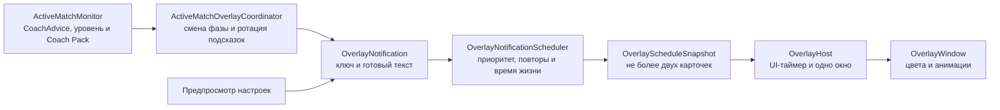

# Игровой оверлей TempoCue

## Текущее состояние

`TempoCue.Overlay` содержит нейтральный контракт уведомления, детерминированный планировщик и отдельное WPF-окно. Модуль не знает Riot DTO, `MatchState`, Coach Pack и язык интерфейса: приложение передаёт ему уже готовый текст и стабильный ключ события.

Текущая итерация реализует:

- два видимых слота без неограниченной очереди;
- обновление одного события на месте по стабильному ключу;
- порядок `Danger → Caution → Information → Coach → NoData`;
- отдельное постоянное состояние `Paused`;
- подавление завершившегося повтора на 20 секунд;
- ограниченную двумя элементами очередь ожидания, из которой устаревшие сообщения удаляются через 20 секунд;
- автоматическое исчезновение и WPF-анимации;
- время показа от 5–8 секунд для коротких системных сообщений и до 16 секунд для длинных советов с учётом объёма читаемого текста;
- игровой режим с пропусканием мыши и режим настройки с перетаскиванием и закрытием;
- локализованный пошаговый предпросмотр заполнения двух слотов и приоритетного вытеснения без League и Riot API;
- показ настоящего совета активной фазы выбранного матчап-набора;
- последовательную подачу постоянных подсказок при повышении уровня без смены фазы.
- сохранение включения, ширины, прозрачности фона, положения и времени показа;
- три режима постоянных советов: каждый один раз за матч, ротация по уровням и отключение;
- глобальную горячую клавишу `Ctrl+Alt+O` для безопасного режима настройки.

`ActiveMatchOverlayCoordinator` подписывается на общий `ActiveMatchMonitor` в `TempoCue.App`, получает уже выбранный движком `CoachAdvice` и преобразует его в нейтральный `OverlayNotification`. Сам модуль `TempoCue.Overlay` по-прежнему не знает о матче, Coach Pack и локализации.

Один и тот же фазовый совет не отправляется при каждом секундном снимке. Координатор запоминает пару `PackId + RuleId` и показывает новое фазовое уведомление только при смене активной фазы или набора. Если уровень повысился без смены фазы, координатор выбирает одну применимую постоянную подсказку: сначала ещё не показанную подсказку текущей фазы, затем ещё не показанную общую. Полностью пройденный список повторяется детерминированно, но одна подсказка не может повториться раньше чем через три уровня. Смена фазы имеет приоритет и не сопровождается второй карточкой постоянной подсказки в том же обновлении.

При первом определении матчапа показывается только актуальная фаза, а уровень становится начальной точкой для последующих подсказок. По умолчанию каждая подходящая постоянная подсказка показывается один раз за матч. Пользователь может вернуть ротацию по уровням либо полностью отключить автоматический показ постоянных советов; смены фаз и будущие опасные события от этой настройки не зависят. Состояние фаз и ротации сбрасывается при отсутствии матча, загрузке новой игры либо явном откате игрового времени. Кратковременный timeout чтения ничего не повторяет.

Настройки хранятся в `%LocalAppData%\TempoCue\settings.json`. Положение записывается как доля доступной рабочей области, поэтому после смены разрешения или DPI окно остаётся внутри экрана. Режим настройки доступен даже при выключенных игровых уведомлениях: это позволяет сначала подобрать ширину, прозрачность и положение, а затем включить оверлей.

## Поток данных

`OverlayNotificationScheduler` не использует WPF и системные таймеры. Текущее время передаётся каждым вызовом, поэтому одинаковая последовательность уведомлений и моментов времени всегда даёт одинаковый результат.

## Контракт уведомления

Уведомление содержит:

- `Key` — стабильный идентификатор события для обновления на месте и подавления повторов;
- `Status` — короткое название состояния;
- `Context` — необязательный тайминг, уровень или давность наблюдения;
- `Phrase` — одна основная фраза;
- `Source` — источник, причина или степень достоверности;
- `Badge` — необязательная системная метка;
- `Tone` — одно из шести визуальных состояний;
- `DismissLabel` — доступная подпись закрытия в режиме настройки.

В контракте нет WPF-цветов и игровых моделей. Матчапы и будущий контроль карты могут использовать один механизм, не расширяя окно знаниями о типах игровых событий.

## Приоритеты и вытеснение

1. `Danger` показывается немедленно, очищает менее важные карточки и занимает верхний слот.
2. `Caution` вытесняет активные `Coach` и `NoData`, но может находиться рядом с информационным событием.
3. `Information` предназначен для нейтральных фактов и таймеров.
4. `Coach` ожидает, пока нет активного `Danger` или `Caution`.
5. `NoData` имеет минимальный приоритет.
6. `Paused` очищает остальные карточки, не исчезает автоматически и блокирует новые уведомления до явного скрытия.

При одинаковом приоритете новое событие заменяет старое в том же уровне. Низкоприоритетные карточки показываются не чаще одной в восемь секунд; предупреждения обходят это ограничение. В очереди остаются только два наиболее важных и свежих события.

## Время жизни и анимации

| Состояние | Время жизни |
|---|---:|
| `Danger` | 8 секунд |
| `Caution` | 6 секунд |
| `Information` | 5 секунд |
| `Coach` | 7 секунд |
| `NoData` | 5 секунд |
| `Paused` | до явного скрытия |

- обычное появление: 180 мс, прозрачность `0 → 1` и сдвиг на 8 px;
- появление `Danger`: 120 мс без задержки;
- исчезновение: 150 мс, только затухание;
- обновление того же `Key`: без повторной анимации появления;
- при отключённых системных анимациях сдвиг не используется.

Фон карточки имеет непрозрачность 80%, а текст, цветовая полоса и подписи остаются полностью непрозрачными. Цвета шести состояний взяты из актуального макета.

## Ручная проверка

1. Запустить новую Release-сборку TempoCue.
2. Открыть «Настройки» → «Игровой оверлей».
3. Изменить ширину и прозрачность, нажать «Настроить оверлей»: должны появиться две карточки с выбранными параметрами.
4. Перетащить карточки, нажать «Сохранить настройки», повторно открыть режим настройки и проверить сохранённое положение.
5. Выключить оверлей и убедиться, что кнопка «Настроить оверлей» остаётся доступной.
6. Выбрать фиксированное время и убедиться, что слайдер появляется только в этом режиме; вернуть автоматический режим и проверить, что он скрывается.
7. Изменить любой параметр: внизу должна появиться отметка о несохранённых изменениях; после сохранения она должна исчезнуть.
8. После возврата значений по умолчанию проверить ширину 340 px, отступ 24 px справа и 80 px сверху, а также отсутствие кнопки на панели задач.
9. Убедиться, что карточки плавно появляются и самостоятельно гаснут.
10. В режиме предпросмотра перетащить карточку за её фон и закрыть крестиком.
11. Переключить интерфейс на английский без перезапуска и повторно проверить подписи настроек.
12. Включить подходящий матчап-набор, запустить матч и проверить, что после определения матчапа появляется совет текущей фазы.
13. Дождаться нескольких секундных обновлений: тот же совет не должен появляться повторно.
14. Перейти на уровень следующей фазы и проверить новое уведомление с её цветом, названием набора и фактическим уровнем игрока.
15. Повысить уровень внутри той же фазы и проверить одну постоянную подсказку со статусом «Подсказка по матчапу».
16. Убедиться, что при смене фазы на повышении уровня появляется только фазовый совет, а постоянная подсказка переносится на следующее повышение без смены фазы.
17. В режиме «один раз за матч» убедиться, что исчерпанный список не повторяется; в режиме ротации проверить прежний минимальный разрыв в три уровня.
18. Открыть оверлей, закрыть главное окно TempoCue и убедиться, что процесс завершается, а следующая Release-сборка не сообщает о заблокированном `TempoCue.App.exe`.

Два слота, все цвета и вытеснение дополнительно проверяются STA-тестом со снимком `overlay-two-cards-ru.png` и unit-тестами планировщика.

## Следующие итерации

1. Добавить выбор монитора League и обработку его смены во время матча.
2. Добавить горячие клавиши паузы и временного скрытия оверлея.
3. Проверить поверх оконного и безрамочного режима League; эксклюзивный полноэкранный режим может потребовать другого Windows-механизма.
4. После матчапов подключить уведомления контроля карты к тому же контракту.
